

  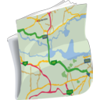

<h1 align="center">Organic Maps</h1>

**Organic Maps** is a privacy-first offline maps & GPS app for hiking, cycling, biking, and driving. Absolutely free. No ads. No tracking. Created and maintained by MapsWithMe (MAPS.ME) founders, developed with love by the open-source community. Powered by [OpenStreetMap](https://www.openstreetmap.org) data. Installed by [over 6 million users worldwide](https://organicmaps.app/news/2025-12-31/organic-maps-2025-year-in-review/).

[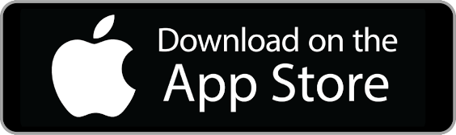](https://apps.apple.com/app/organic-maps/id1567437057)

[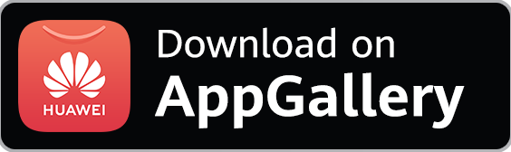](https://appgallery.huawei.com/#/app/C104325611)

[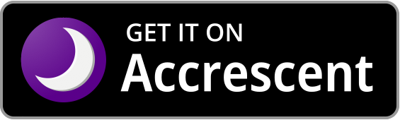](https://accrescent.app/app/app.organicmaps)

  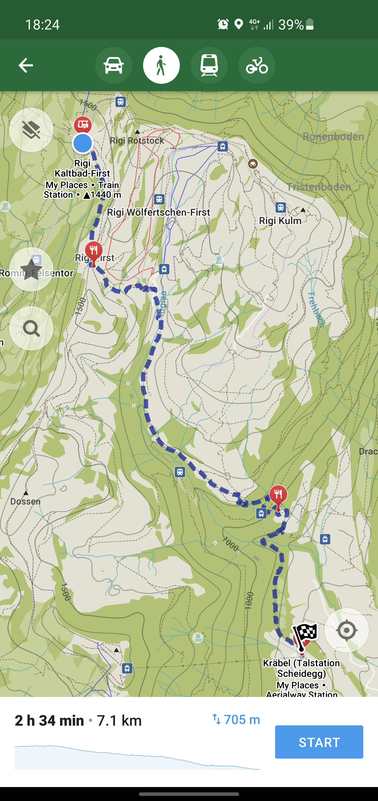
  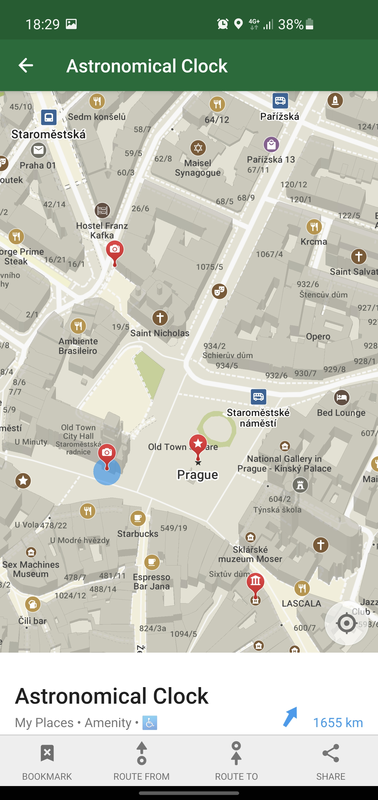
  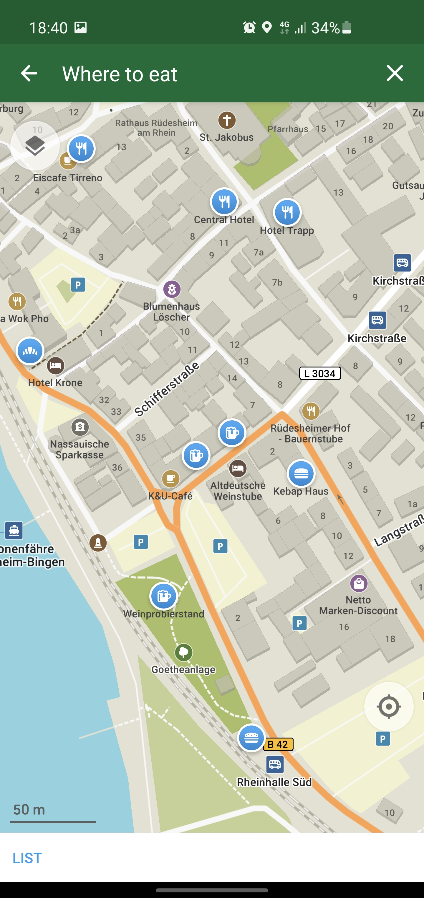
  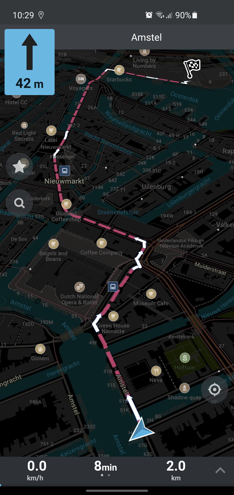

## Features

Organic Maps is the ultimate companion app for travellers, tourists, hikers, and cyclists:

- Detailed offline maps with places that don't exist on other maps, thanks to [OpenStreetMap](https://openstreetmap.org)
- Cycling routes, hiking trails, and walking paths
- Contour lines, elevation profiles, peaks, and slopes
- Turn-by-turn walking, cycling, and car navigation with voice guidance
- Subway maps and public transport routes
- Fast offline search on the map
- Bookmarks and tracks import and export in KML, KMZ, GPX, GeoJSON formats
- Open links from Google Maps, OpenStreetMap, Apple Maps, 2GIS, and `geo:` URLs
- Dark Mode to protect your eyes
- Countries and regions don't take a lot of space
- Wikipedia articles for places of interest
- Free and open-source

## Why Organic?

Organic Maps is pure and organic, made with love:

- Respects your privacy
- Saves your battery
- No unexpected mobile data charges
- Offline and fast
- Open-source alternative to Google Maps, Apple Maps, and MAPS.ME

Organic Maps is free from trackers and other bad stuff:

- No ads
- No tracking
- No data collection
- No phoning home
- No annoying registration
- No mandatory tutorials
- No noisy email spam
- No push notifications
- No crapware
- ~~No pesticides~~ Purely organic!

The Android application is verified by the <a href="https://reports.exodus-privacy.eu.org/en/reports/app.organicmaps/latest/">Exodus Privacy Project:
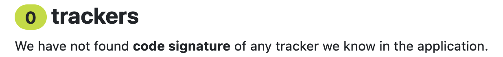</a>

The iOS application is verified by <a href="https://ios.trackercontrol.org/analysis/app.organicmaps">TrackerControl for iOS:
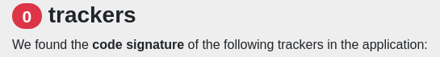</a>

 

Organic Maps doesn't request excessive permissions to spy on you:

  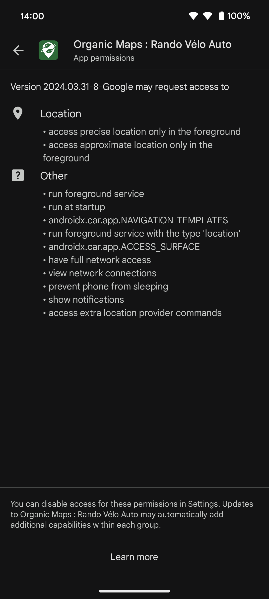
  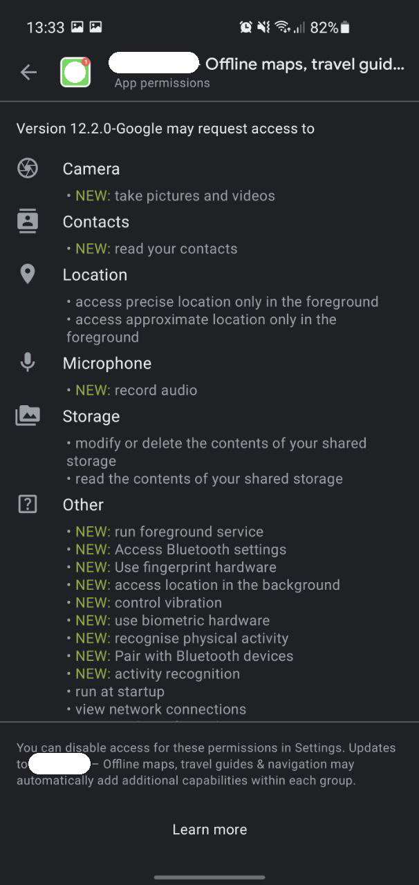

At Organic Maps, we believe that privacy is a fundamental human right:

- Organic Maps is an indie community-driven open-source project
- We protect your privacy from Big Tech's prying eyes
- Stay safe no matter where you are

Reject surveillance - embrace your freedom.

[**Give Organic Maps a try!**](#install)

## Who is paying for the development?

The app is free for everyone, so we rely on your donations. Please donate at [organicmaps.app/donate](https://organicmaps.app/donate/) to support the project!

Beloved institutional sponsors below have provided targeted grants to cover some infrastructure costs and fund development of new selected features:

<table>
  <tr>
    <td>
      <a href="https://nlnet.nl/">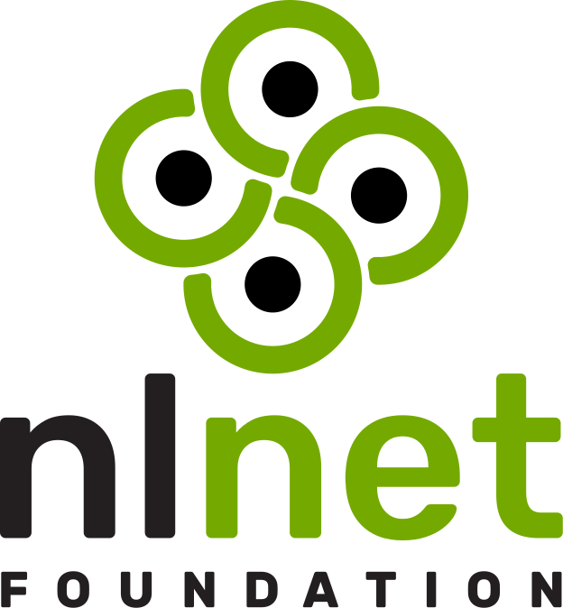</a>
    </td>
    <td>
      <a href="https://github.com/organicmaps/organicmaps/milestone/7">The Search & Fonts improvement project</a> has been <a href="https://nlnet.nl/project/OrganicMaps/">funded</a> through NGI0 Entrust Fund. <a href="https://nlnet.nl/entrust/">NGI0 Entrust Fund</a> is established by the <a href="https://nlnet.nl/">NLnet Foundation</a> with financial support from the European Commission's <a href="https://www.ngi.eu/">Next Generation Internet programme</a>, under the aegis of DG Communications Networks, Content and Technology under grant agreement No 101069594.
    </td>
  </tr>
  <tr>
    <td>
      
    </td>
    <td>
      <a href="https://summerofcode.withgoogle.com/">Google</a> backed 5 student's projects in the Google Summer of Code program during <a href="https://summerofcode.withgoogle.com/programs/2022/organizations/organic-maps">2022</a> and <a href="https://summerofcode.withgoogle.com/programs/2023/organizations/organic-maps">2023</a> programs. Noteworthy projects included Android Auto and Wikipedia Dump Extractor.
    </td>
  </tr>
  <tr>
    <td>
      
    </td>
    <td>
      <a href="https://www.mythic-beasts.com/">Mythic Beasts</a> ISP <a href="https://www.mythic-beasts.com/blog/2021/10/06/improving-the-world-bit-by-expensive-bit/">provides us</a> two virtual servers with 400 TB/month of free bandwidth to host and serve maps downloads.
    </td>
  </tr>
</table>
